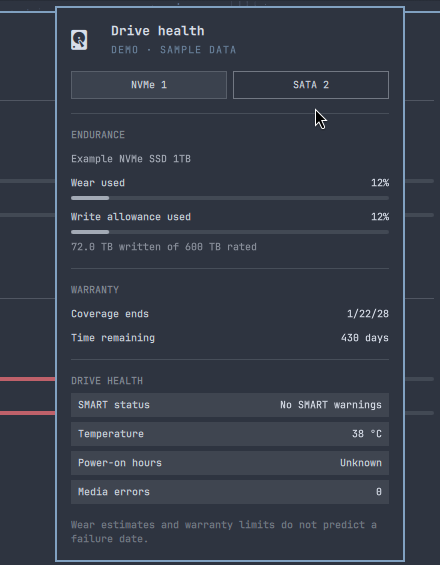

# Drive Health for Omarchy

A distributable SSD monitor for Omarchy's Quickshell plugin system. It shows
SSD SMART status, estimated wear, total writes versus a configured endurance
limit, temperature, and warranty expiry. It does not predict a failure date.



Tested against Omarchy **4.5.0-3**. Requires its Quickshell `Panel`,
`BarIconButton`, `KeyboardPanel`, `PanelKeyCatcher`, and `Translations` APIs.
Older Waybar-based Omarchy releases are not supported. The plugin uses the
native theme, font scale, popup placement, animation preferences, keyboard
navigation, and translation fallback. English is included.

## Try without installation

```sh
./tools/preview
```

Opens a separate demo window using the real UI components and clearly marked
example data. No privileged reads, bar changes, or background service install.
The popup supports Esc to close, up/down or j/k to scroll, left/right or h/l to switch drives, Tab to switch panels,
and R to reread the cache. The standalone preview is a scrollable window.

## Distribution and installation

The repository root is an Omarchy plugin, validated with:

```sh
omarchy plugin validate .
```

Install the widget with:

```sh
omarchy plugin add https://github.com/metacatdud/omarchy-drive-health.git --enable
```

Update it with `omarchy plugin update community.drive-health`.
Live monitoring also requires the collector package below; adding the widget
alone does not install or start the system service.

For a local prototype installation, from this directory:

```sh
mkdir -p ~/.config/omarchy/plugins/community.drive-health
cp manifest.json ./*.qml ~/.config/omarchy/plugins/community.drive-health/
cp -r backend i18n ~/.config/omarchy/plugins/community.drive-health/
omarchy-shell shell rescanPlugins
omarchy plugin enable community.drive-health
```

The unprivileged widget works in demo mode without the collector. Set
`"demo": true` on its entry in `bar.layout` in `~/.config/omarchy/shell.json`:

```json
{"id": "community.drive-health", "demo": true}
```

Remove `demo` or set it to false for live reports. Drives enroll automatically on the first successful read,
and newly connected supported drives enroll on the next scan. Keep the rest of your layout.

### Collector package

From the installed plugin directory:

```sh
cd ~/.config/omarchy/plugins/community.drive-health
./tools/package
cd dist/collector
makepkg -sic
sudo systemctl enable --now omarchy-drive-health.timer
sudo systemctl start omarchy-drive-health.service
```

The generated package recipe has SHA-256 checksums for every source file.
`makepkg -sic` installs the package and its Python/smartmontools/systemd
dependencies. The service is enabled explicitly, not by a package hook.
The timer reads drives hourly, with a small randomized delay. It also samples
after boot and catches up once after missed scheduled runs; it does not wake
a suspended machine or fabricate missed samples. The widget rereads the cache every
minute and when opened; R refreshes the display, not the hardware scan.

The source archive in `dist/` can be shared directly. Publish the source repo
for native Git updates; publish the built collector package alongside releases.
The root PKGBUILD is a staging template; build the generated `dist/collector`
recipe. A future AUR release should use a versioned source URL and checksum.

### Warranty configuration

Select a drive in the popup and click the **gear icon** beside the **Warranty** heading. Enter
its warranty end date (`YYYY-MM-DD`) and rated write allowance (`TBW`), then
click **Save**. The widget immediately recalculates the remaining time and
write allowance. Leave either field blank to clear it; **Cancel** discards
unsaved edits. Dates are checked for calendar validity, and TBW must be a
positive number. Decimal dots and commas are accepted. Saving requires no
administrator privileges. Demo mode allows viewing the form but disables Save.

Settings are saved privately under your user account, merging the selected
drive into the file and preserving other drives and unrelated metadata.

For manual configuration, create `~/.config/omarchy-drive-health/drives.json` (or the equivalent under
`$XDG_CONFIG_HOME`). Find each drive's configuration ID in the local cache with
`jq '.drives[] | {model, id}' /var/lib/omarchy-drive-health/report.json`:

```json
{
  "drives": {
    "replace-with-drive-configuration-id": {
      "rated_tbw": 600,
      "warranty_until": "2030-06-15"
    }
  }
}
```

Both values are optional; the numbers above are examples. Use the applicable
manufacturer/OEM terms and purchase receipt. Warranty end dates are entered
explicitly so we do not confuse power-on hours with calendar age or assume a
universal warranty duration. Write-limit consumption and calendar expiry are
displayed independently. This is tracking, not a determination of coverage.

Drive IDs hash model and serial; renaming `/dev/sda` to `/dev/sdb` does not
break the association. If the drive supplies no serial, the device path is
used and its ID may change. Raw serial numbers are not written to the cache.

## Supported readings and limitations

- Internal NVMe: standard wear used, written TB (512,000 bytes per data unit),
  spare percentage, media errors, critical warning, and temperature.
- Internal SATA SSDs: SMART health and temperature; standardized
  `endurance_used.current` when smartmontools supplies it. Samsung consumer
  SSDs also have a decoder for attributes 177 and 241. Other vendor-specific
  counters remain **unknown**, not zero or an invented percentage.
- Rotational disks, USB bridges, RAID adapters, and unusual device names are
  excluded in this prototype. At most 64 scanned entries are considered.
- Wear at/above 90% is highlighted as a planning threshold. Values over 100%
  remain visible. Critical status requires an actual SMART failure/warning.
- Partial reads, historical SMART errors, missing dependencies, and reports
  older than two hours are surfaced. No healthy status is inferred from an
  empty report. A drive reporting SMART pass does not prove it cannot fail.
- No desktop notifications, write-rate forecasts, automatic firmware updates,
  self-tests, or warranty lookup.

## Enrollment and history

The root-owned SQLite database at
`/var/lib/omarchy-drive-health/history.sqlite3` keeps each drive's first/last
observation and last successful reading. A disconnected drive stays enrolled,
shows unavailable, and resumes its existing history if reconnected. Drive
identity follows model + serial rather than the current Linux device name.

Hourly snapshots retain temperature, wear, writes, errors, spare capacity,
and power-on hours for **90 days**. Repeated manual scans in the same UTC
hour update that hour's sample instead of creating duplicate hourly points.
Daily write summaries are retained for **five years**. History remains
available in the local database and report; the compact popup shows
endurance, warranty, and health without a daily-history section.

Daily totals are the difference between the day's first and last observed
write counters, using UTC day boundaries. The displayed observation span
makes partial days explicit. A single observation has an unknown total;
missing days are not zero-filled. A counter decrease invalidates that day's
write total. These are observed within-day writes, not an estimate of all
writes since midnight or a reconstruction of activity before installation.

The history database is private to root; only the small sanitized report is
readable by the widget. It never modifies the user's warranty configuration.

## Explainable warnings

Warnings now include their specific SMART reason and the observations behind
any counter comparison. A counter already above zero when first observed is
labeled as a baseline with unknown earlier history. Later readings show the
numeric increase or that the value is unchanged from a dated reading. The
last observed increase remains available on subsequent unchanged readings.

Observation timestamps are not failure-event timestamps. Counter decreases
restart the comparison baseline; missing values are not treated as zero.
Current pending-sector and offline-uncorrectable counts are described as
counts, not assumed to be lifetime totals. We never infer a failure date,
repair, or safety from these comparisons. Existing warning severity remains
in place even for an unchanged nonzero error count.

NVMe critical-warning bits receive specific explanations when recognized;
unrecognized bits remain a generic critical warning. Current ATA attribute
threshold failures are distinguished from past threshold crossings and
error/self-test log records using the smartctl exit-status bit definitions.

The comparison state is stored with each drive's existing history record.
Upgrades preserve previous observations and use previously recorded NVMe
media-error values when available. Newly supported SATA counters start a
baseline when first collected. No additional scans, timers, or background
processes are introduced.

Sources: [smartctl exit-status documentation](https://github.com/smartmontools/smartmontools/blob/main/src/smartctl.8.in)
and [NVMe health-log definitions](https://learn.microsoft.com/en-us/windows/win32/api/nvme/ns-nvme-nvme_health_info_log).

## Architecture and security

See [the Omarchy integration analysis](docs/architecture.md).

The root-owned systemd collector executes a fixed read-only smartctl command
with argument arrays. It discovers drives on every run, writes an atomic
cache at `/var/lib/omarchy-drive-health/report.json`, and never reads user
configuration. It has no network function. It needs raw device access, so
`PrivateDevices` is deliberately not enabled. The service confines filesystem
writes to its state directory and temporary directory.

The shell remains unprivileged. It reads the cache and merges warranty
settings locally. There are no sudoers entries, disk-group grants, polkit
bypasses, credentials, or username/model/path-specific installation values.
All users on the machine can read the sanitized model/device/health cache;
hashing serials reduces casual exposure but does not make the IDs anonymous.
Dynamic labels render as plain text. Unknown metrics are nullable.

## Validate

```sh
make test
./tools/preview --smoke
./tools/preview --settings-smoke
systemd-analyze verify systemd/omarchy-drive-health.{service,timer}
```

The smoke test opens and closes the actual native popup in a temporary shell,
then exits. Tests cover unit conversion, identity stability, vendor isolation,
SMART error bitmasks, missing data, warranty boundaries, stale reports,
discovery filtering, atomic cache writes, and plain-text display sinks.

Tests cover synthetic SMART input and history persistence; the native popup
is also smoke-tested in a real Omarchy desktop. Live collection has been verified on an Intel 660p NVMe SSD and a Samsung
860 QVO SATA SSD with smartmontools 7.5. Both auto-enroll and report their
existing lifetime counters. Other vendors still need broader hardware validation.

## Remove

```sh
omarchy plugin remove community.drive-health
sudo systemctl disable --now omarchy-drive-health.timer
sudo systemctl stop omarchy-drive-health.service
sudo pacman -R omarchy-drive-health-collector
```

Your optional warranty configuration, history database, and last cache are retained. Remove
them separately if you no longer want them.

MIT licensed.
